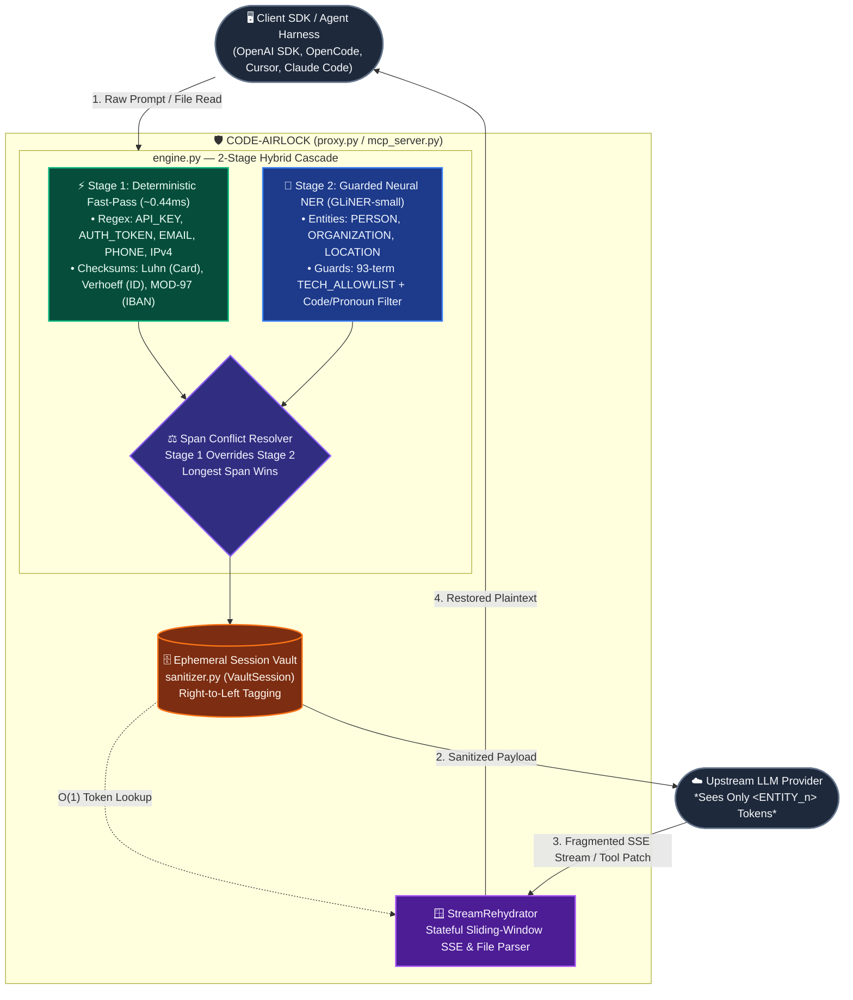

# 🛡️ Code-Airlock

**Low-Latency AI Privacy, Secret/PII Redaction & Streaming Rehydration Gateway (`OpenAI Proxy` + `FastMCP Server`)**

`code-airlock` is a zero-trust privacy layer for LLMs and agentic coding harnesses. It intercepts sensitive credentials, financial identifiers, and personal data before they leave your machine, replaces them with deterministic session tokens (`<API_KEY_1>`, `<PERSON_1>`), and seamlessly rehydrates them back into real-time Server-Sent Events (SSE) token streams or local file writes.

* **Dual Deployment Modes:** Run as a drop-in **OpenAI-compatible `/v1/chat/completions` reverse proxy** or as a **Model Context Protocol (MCP) server** (`stdio`) for OpenCode, Cursor, and Claude Code.
* **2-Stage Hybrid Cascade:** Combines sub-millisecond deterministic regex + mathematical checksums (**Luhn, Verhoeff $D_5$, ISO 7064 MOD-97**) with contextual neural NER (`urchade/gliner_small-v2.1`) and a 93-term developer allowlist.
* **Zero-Delay Streaming Rehydration:** Stateful sliding-window SSE parser reassembles split tokens across arbitrary 2-byte network chunks without delaying code comparison or bitwise operators (`<`, `<<`, `template <typename T>`).
* **Minimalist Systems Footprint:** ~770 lines of flat, auditable Python across 7 files (`engine.py`, `sanitizer.py`, `proxy.py`, `mcp_server.py`, `benchmark.py`, and test suites).

---

## 🏗️ System Architecture



---

## 📊 Gold-Set Benchmark (`gold_set.jsonl`)

Evaluated on **285 developer prompts** (sampled from `CodeAlpaca_20K` and `OpenCodeInstruct` with injected `.env` blocks, ticket escalations, billing metadata, and C++ template syntax) totaling **744 ground-truth PII spans** across 11 categories:

| Metric / Entity Category | Strict (P / R / F1) | Partial (P / R / F1) | Latency / Verification |
| :--- | :---: | :---: | :--- |
| **Overall Benchmark (744 Spans)** | **96.5% / 99.1% / 97.7%** | **97.0% / 99.6% / 98.3%** | **285 / 285 SSE Round-Trip Pass** |
| **Stage 1 Latency (Deterministic)** | — | — | **0.44 ms (p50)** / 0.78 ms (p95) |
| **Total Cascade Latency (CPU/GPU)** | — | — | **14.6–42.5 ms (p50)** |
| `API_KEY` *(OpenAI, AWS, GitHub, Slack, Anthropic)* | 100 / 100 / **100%** | 100 / 100 / **100%** | Prefix + length/charset bounds |
| `AUTH_TOKEN` *(JWT, Bearer, PEM Private Keys)* | 100 / 100 / **100%** | 100 / 100 / **100%** | 3-part Base64URL + PEM headers |
| `CREDIT_CARD` *(13–19 digits)* | 100 / 100 / **100%** | 100 / 100 / **100%** | Pure-Python **Luhn Checksum** |
| `GOVT_ID` *(SSN, PAN, 12-Digit National ID)* | 100 / 100 / **100%** | 100 / 100 / **100%** | **Verhoeff $D_5$ Checksum** |
| `IBAN_CRYPTO` *(IBAN, ETH `0x...`)* | 100 / 100 / **100%** | 100 / 100 / **100%** | **ISO 7064 MOD-97** Checksum |
| `EMAIL` & `PHONE` | 100 / 100 / **100%** | 100 / 100 / **100%** | Negative lookbehind for order IDs |
| `IP_ADDRESS` *(IPv4)* | 94 / 100 / **97%** | 94 / 100 / **97%** | Octet range `0..255` (rejects `.300`) |
| `PERSON` | 99 / 99 / **99%** | 99 / 99 / **99%** | Pronoun + code-identifier stopword guard |
| `ORGANIZATION` | 89 / 95 / **92%** | 91 / 97 / **94%** | Filtered via 93-term `TECH_ALLOWLIST` |
| `LOCATION` | 88 / 98 / **93%** | 90 / 100 / **95%** | Adjacent comma-span coalescing |

* **Hard-Negative Suite:** **61/61 Passed** (100% rejection of non-Luhn 16-digit order IDs, Verhoeff-invalid 12-digit numbers, MOD-97-invalid IBANs, and `v192.168.1.300` version strings).
* **Tech Allowlist Check:** **30/30 Passed** (`FastAPI`, `Docker`, `Kubernetes`, `Redis`, `Postgres`, `AWS`, `Heroku`, etc. produce zero false positives).

---

## 🚀 Quickstart & MCP Setup

### Option 1: Zero-Install via `uvx` (Recommended)

No cloning, manual virtual environments, or path debugging. Anyone with Astral's [`uv`](https://github.com/astral-sh/uv) can run `code-airlock` directly from PyPI:

#### 🤖 Claude Code (CLI)
```bash
claude mcp add code-airlock -- uvx code-airlock
```

#### 💻 OpenCode (`opencode.json`)
```json
{
  "$schema": "https://opencode.ai/config.json",
  "mcp": {
    "code-airlock": {
      "type": "local",
      "command": ["uvx", "code-airlock"],
      "enabled": true
    }
  }
}
```

#### 🖱️ Cursor (`.cursor/mcp.json`)
```json
{
  "mcpServers": {
    "code-airlock": {
      "command": "uvx",
      "args": ["code-airlock"]
    }
  }
}
```

#### 🖥️ Claude Desktop (`claude_desktop_config.json`) & Windsurf (`~/.codeium/windsurf/mcp_config.json`)
```json
{
  "mcpServers": {
    "code-airlock": {
      "command": "uvx",
      "args": ["code-airlock"]
    }
  }
}
```

*(You can also run directly from source via `uvx --from git+https://github.com/sarthexe/code-airlock code-airlock`)*.

---

### Option 2: Local Development / Manual Git Clone

```bash
git clone https://github.com/sarthexe/code-airlock.git
cd code-airlock
pip install -r requirements.txt
pip install -e .

# Test tools locally over stdio
python mcp_server.py
```

---

### Option 3: OpenAI-Compatible Reverse Proxy (`/v1/chat/completions`)

Run as a transparent privacy gateway intercepting HTTP requests:

```bash
# Run with built-in zero-leak mock upstream (offline validation)
uvicorn proxy:app --port 8000

# Or point to a live upstream provider (OpenAI, Ollama, OpenRouter, vLLM)
export AIRLOCK_UPSTREAM_URL="https://api.openai.com"
uvicorn proxy:app --port 8000
```

---

## 🧠 Guiding Your Agent (`.cursorrules` / System Prompt)

To ensure your coding agent actually leverages the airlock tools instead of raw file reads, include this rule in your `.cursorrules`, `CLAUDE.md`, or system instructions:

```markdown
# Code-Airlock Agent Guardrails
1. When reading `.env`, configuration, or log files, NEVER use standard read tools. ALWAYS call `airlock_read_file(path)` so secrets and PII are redacted into `<ENTITY_n>` tokens before hitting context.
2. When creating or editing configs, write the `<ENTITY_n>` tokens directly and call `airlock_write_file(path, content)`. The airlock will rehydrate the real secrets locally on disk without ever sending them through the LLM.
3. Call `airlock_vault_status()` to inspect active pseudonymized tokens safely (never returns plaintext values).
```

## 📁 Repository Structure

| File | Lines | Responsibility |
| :--- | :---: | :--- |
| `engine.py` | 183 | Stage 1 regex/checksum validators + Stage 2 GLiNER-small + `TECH_ALLOWLIST` + span merger |
| `sanitizer.py` | 93 | Session-consistent `VaultSession` dehydrator + stateful `StreamRehydrator` SSE parser |
| `proxy.py` | 143 | FastAPI `/v1/chat/completions` gateway with SSE streaming rehydration & telemetry headers |
| `mcp_server.py` | 71 | FastMCP `stdio` server exposing 5 zero-leak text and file tools for agentic harnesses |
| `benchmark.py` | 132 | Strict/Partial overlap evaluator, p50/p95 latency timer, and hard-negative verifier |
| `test_proxy.py` | 85 | End-to-end proxy tests (11-entity zero-leak check, 2-char SSE split rehydration, C++ syntax) |
| `test_mcp.py` | 66 | MCP tool verification (`.env` $\rightarrow$ `config.json` zero-leak file migration & vault safety) |
