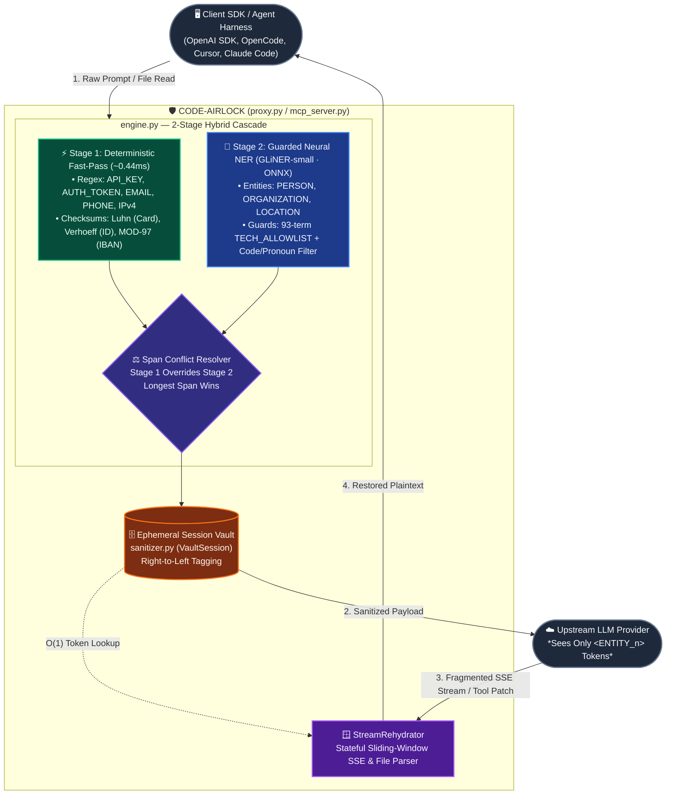

# 🛡️ Code-Airlock

**Low-Latency AI Privacy, Secret/PII Redaction & Streaming Rehydration Gateway (`OpenAI Proxy` + `FastMCP Server`)**

`code-airlock` is a zero-trust privacy layer for LLMs and agentic coding harnesses. It intercepts sensitive credentials, financial identifiers, and personal data before they leave your machine, replaces them with deterministic session tokens (`<API_KEY_1>`, `<PERSON_1>`), and seamlessly rehydrates them back into real-time Server-Sent Events (SSE) token streams or local file writes.

* **Dual Deployment Modes:** Run as a drop-in **OpenAI-compatible `/v1/chat/completions` reverse proxy** or as a **Model Context Protocol (MCP) server** (`stdio`) for OpenCode, Cursor, and Claude Code.
* **2-Stage Hybrid Cascade:** Combines sub-millisecond deterministic regex + mathematical checksums (**Luhn, Verhoeff $D_5$, ISO 7064 MOD-97**) with contextual neural NER (`onnx-community/gliner_small-v2.1` on **ONNX Runtime**) and a curated developer allowlist.
* **Deterministic Secret Coverage:** Stage 1 also captures inline connection-string passwords and `PASSWORD` / `SECRET` / `ACCESS_TOKEN` / `API_KEY` assignments, excluding placeholders, booleans, function calls, and existing vault tokens.
* **Git & CI Guardrails:** `code-airlock scan --staged` catches secrets in staged files at sub-millisecond Stage 1 speed, masks every value in output, and installs a `.git/hooks/pre-commit` gate via `init --pre-commit`.
* **Safe Agent Execution:** `airlock_exec` injects real `.env` values into a guarded subprocess (`shell=False`) and scrubs both stdout and stderr before returning them to the model.
* **Project-Aware Rules:** `.airlock.toml` adds team allowlist terms and custom Stage-1 regexes such as `EMPLOYEE_ID = 'EMP-[0-9]{6}'`.
* **Zero-Delay Streaming Rehydration:** Stateful sliding-window SSE parser reassembles split tokens across arbitrary 2-byte network chunks without delaying code comparison or bitwise operators (`<`, `<<`, `template <typename T>`).
* **Minimalist Systems Footprint:** ~850 lines of core runtime code (`engine.py`, `onnx_ner.py`, `sanitizer.py`, `proxy.py`, `mcp_server.py`, `scanner.py`, `config.py`, `executor.py`) plus a deterministic 2,000-row benchmark harness. One universal install — no PyTorch, no CUDA toolkit.

---

## 🏗️ System Architecture



---

## 📊 Gold-Set Benchmark (`benchmarks/gold_set.jsonl`)

Evaluated on **285 developer prompts** (sampled from `CodeAlpaca_20K` and `OpenCodeInstruct` with injected `.env` blocks, ticket escalations, billing metadata, and C++ template syntax) totaling **744 ground-truth PII spans** across 11 categories:

| Metric / Entity Category | Strict (P / R / F1) | Partial (P / R / F1) | Latency / Verification |
| :--- | :---: | :---: | :--- |
| **Overall Benchmark (744 Spans)** | **96.5% / 99.1% / 97.7%** | **97.0% / 99.6% / 98.3%** | **285 / 285 SSE Round-Trip Pass** |
| **Stage 1 Latency (Deterministic)** | — | — | **0.44 ms (p50)** / 0.78 ms (p95) |
| **Total Cascade Latency (CPU/GPU)** | — | — | **14.6–42.5 ms (p50)** |
| `API_KEY` *(OpenAI, AWS, GitHub, Slack, Anthropic)* | 100 / 100 / **100%** | 100 / 100 / **100%** | Prefix + length/charset bounds |
| `AUTH_TOKEN` *(JWT, Bearer, PEM Private Keys)* | 100 / 100 / **100%** | 100 / 100 / **100%** | 3-part Base64URL + PEM headers |
| `CREDIT_CARD` *(13–19 digits)* | 100 / 100 / **100%** | 100 / 100 / **100%** | Pure-Python **Luhn Checksum** |
| `GOVT_ID` *(SSN, PAN, 12-Digit National ID)* | 100 / 100 / **100%** | 100 / 100 / **100%** | **Verhoeff $D_5$ Checksum** |
| `IBAN_CRYPTO` *(IBAN, ETH `0x...`)* | 100 / 100 / **100%** | 100 / 100 / **100%** | **ISO 7064 MOD-97** Checksum |
| `EMAIL` & `PHONE` | 100 / 100 / **100%** | 100 / 100 / **100%** | Negative lookbehind for order IDs |
| `IP_ADDRESS` *(IPv4)* | 94 / 100 / **97%** | 94 / 100 / **97%** | Octet range `0..255` (rejects `.300`) |
| `PERSON` | 99 / 99 / **99%** | 99 / 99 / **99%** | Pronoun + code-identifier stopword guard |
| `ORGANIZATION` | 89 / 95 / **92%** | 91 / 97 / **94%** | Filtered via 93-term `TECH_ALLOWLIST` |
| `LOCATION` | 88 / 98 / **93%** | 90 / 100 / **95%** | Adjacent comma-span coalescing |

* **Hard-Negative Suite:** **61/61 Passed** (100% rejection of non-Luhn 16-digit order IDs, Verhoeff-invalid 12-digit numbers, MOD-97-invalid IBANs, and `v192.168.1.300` version strings).
* **Tech Allowlist Check:** **30/30 Passed** (`FastAPI`, `Docker`, `Kubernetes`, `Redis`, `Postgres`, `AWS`, `Heroku`, etc. produce zero false positives).

---

## 🧪 Unified 2,000-Row Benchmark Matrix

`benchmarks/build_benchmarks.py` deterministically generates four stratified splits into the git-ignored `benchmarks/` directory (`seed=42`). `benchmarks/benchmark.py` evaluates them and writes [`benchmarks/BENCHMARK_RESULTS.md`](benchmarks/BENCHMARK_RESULTS.md).

| Split | Rows | Positive | Clean / Hard-neg | Ground-truth spans |
| :--- | ---: | ---: | ---: | ---: |
| `dev_prompts` | 1,000 | 600 | 300 / 100 | 2,400 |
| `git_leaks` | 500 | 350 | 0 / 150 | 1,400 |
| `mcp_configs` | 250 | 200 | 50 / 0 | 800 |
| `adversarial_sse` | 250 | 250 | 0 / 0 | 1,217 |
| **Total** | **2,000** | **1,400** | **350 / 250** | **5,817** |

Reference result (strict exact-span matching, `code-airlock` v1.4.0 on CPU ONNX Runtime):

| Split | Strict P / R / F1 | Hard-neg | Clean 0-FP | SSE 1/2/7-byte |
| :--- | :---: | :---: | :---: | :---: |
| `dev_prompts` | 100% / 100% / 100% | 100/100 | 300/300 | 1000/1000 |
| `git_leaks` | 100% / 100% / 100% | 150/150 | — | 500/500 |
| `mcp_configs` | 100% / 100% / 100% | — | 50/50 | 250/250 |
| `adversarial_sse` | 100% / 100% / 100% | — | — | 250/250 |
| **Combined** | **100% / 100% / 100%** | **250/250** | **350/350** | **2000/2000** |

- Latency (CPU ONNX Runtime): **0.203 ms** p50 / 0.433 ms p95 Stage 1; **55.201 ms** p50 / 132.592 ms p95 Stage 2; **55.302 ms** p50 / 132.668 ms p95 total cascade. GPU execution automatically uses `CUDAExecutionProvider` when available.
- Per-entity support: `API_KEY` 756, `AUTH_TOKEN` 467, `CREDIT_CARD` 440, `EMAIL` 754, `PHONE` 465, `IP_ADDRESS` 442, `GOVT_ID` 465, `IBAN_CRYPTO` 465, `PERSON` 729, `ORGANIZATION` 417, `LOCATION` 417. Every entity is at **100% P/R/F1**.
- Invariants: MCP JSON parse **100/100**, JSON round-trip **100/100**, adversarial SSE **2,000/2,000**, hard negatives **250/250**, clean rows **350/350 with zero false positives**.

These are **synthetic, template-composed fixtures**, so the perfect headline is a regression/invariant result, not a claim of real-world accuracy. The older real-world suites (`benchmarks/gold_set.jsonl`: 96.7/99.1/97.9; Gitleaks artifacts: 100/88.5/93.9) remain the honest field tests.

### 🤗 Published Dataset

One command publishes all four splits and the auto-generated card:

```bash
python benchmarks/export_hf.py --repo-id sarthexe/pii-airlock-bench
```

Dataset: [**sarthax/pii-airlock-bench**](https://huggingface.co/datasets/sarthax/pii-airlock-bench) (the token owner namespace is resolved automatically).

```python
from datasets import load_dataset
ds = load_dataset("sarthax/pii-airlock-bench")
```

---

## 🚀 Quickstart & MCP Setup

### Option 1: Zero-Install via `uvx` (Recommended)

No cloning, manual virtual environments, or path debugging. Anyone with Astral's [`uv`](https://github.com/astral-sh/uv) can run `code-airlock` directly from PyPI:

#### 🤖 Claude Code (CLI)
```bash
claude mcp add code-airlock -- uvx code-airlock
```

#### 💻 OpenCode (`opencode.json`)
```json
{
  "$schema": "https://opencode.ai/config.json",
  "mcp": {
    "code-airlock": {
      "type": "local",
      "command": ["uvx", "code-airlock"],
      "enabled": true
    }
  }
}
```

#### 🖱️ Cursor (`.cursor/mcp.json`)
```json
{
  "mcpServers": {
    "code-airlock": {
      "command": "uvx",
      "args": ["code-airlock"]
    }
  }
}
```

#### 🖥️ Claude Desktop (`claude_desktop_config.json`) & Windsurf (`~/.codeium/windsurf/mcp_config.json`)
```json
{
  "mcpServers": {
    "code-airlock": {
      "command": "uvx",
      "args": ["code-airlock"]
    }
  }
}
```

*(You can also run directly from source via `uvx --from git+https://github.com/sarthexe/code-airlock code-airlock`)*.

For a local editable checkout, use the package entrypoint instead of an
absolute path:

```json
{
  "mcpServers": {
    "code-airlock": {
      "command": "python",
      "args": ["-m", "code_airlock.mcp_server"]
    }
  }
}
```

`python -m code_airlock` starts the same MCP server.

---

### Option 2: Local Development / Manual Git Clone

```bash
git clone https://github.com/sarthexe/code-airlock.git
cd code-airlock
pip install -e ".[dev,benchmark]"

# Optional: GPU inference (ONNX Runtime otherwise uses the CPU provider)
pip install onnxruntime-gpu

# Test tools locally over stdio
python -m code_airlock

# Or run the explicit MCP entrypoint
code-airlock-mcp
```

### Zero-Friction CLI

```bash
python -m code_airlock doctor              # model warmup + round-trip + MCP config
python -m code_airlock init                # add rules to .cursorrules / CLAUDE.md
python -m code_airlock init --pre-commit   # also install .git/hooks/pre-commit
python -m code_airlock init --config       # create a starter .airlock.toml
python -m code_airlock scan --staged       # fast Stage 1 scan of staged files
python -m code_airlock scan --deep src/    # add ONNX GLiNER detection for a path
python -m code_airlock proxy               # start the HTTP proxy
python -m code_airlock                     # start the MCP server (default)
```

Installed entrypoints: `code-airlock-mcp`, `code-airlock-proxy`, and the
backward-compatible `code-airlock` alias.

`scan` skips binaries, files over 1 MB, `tests/`, and benchmark fixtures. It
prints `file:line -> [CATEGORY] masked-preview` and exits `1` when secrets are
found, so it works unchanged in CI and Git hooks. `--deep` enables Stage 2 NER;
the default Stage 1 path is sub-millisecond. `init` is idempotent, and
`init --pre-commit` installs a hook that runs `python -m code_airlock scan --staged`.

### 🧰 MCP Tools

| Tool | Purpose |
| :--- | :--- |
| `airlock_read_file` | Read a bounded UTF-8 file through the vault; blocks `.ssh`, `.aws`, `.gnupg`, `.kube`, `/etc`, `System32`, `AIRLOCK_WORKSPACE` escapes, binaries, and files over 1 MB. |
| `airlock_write_file` | Rehydrate locally and write; refuses to write if unresolved/hallucinated `<ENTITY_N>` tokens remain. |
| `airlock_scrub_text` | Redact arbitrary in-memory text or terminal output; `use_ner=False` forces the fast Stage 1 path. |
| `airlock_exec` | Run a guarded subprocess (`shell=False`), inject real `.env` values into its environment, and scrub stdout/stderr before returning. Blocks destructive executables and shells. |
| `airlock_vault_status` | Return active token keys and per-category counts only; never raw values. |
| `airlock_dehydrate` | Redact text and return session-stable tokens. |
| `airlock_rehydrate` | Restore canonical, case-mangled, or whitespace-padded vault tokens. |

All file tools resolve paths with `Path.expanduser().resolve()` and jail access
to `AIRLOCK_WORKSPACE` when that variable is set. Rehydration is tolerant of
`<api_key_1>` / `< API_KEY_1 >`, while the SSE `StreamRehydrator` remains
zero-delay and exact.

`airlock_exec` is designed for safe test runs:

```python
airlock_exec(
    [sys.executable, "-c", "import os; print(os.environ['STRIPE_SECRET_KEY'])"],
    ".env",
)
# stdout: "<API_KEY_1>"  ← the real key never reaches the model
```

### ⚙️ Project Config (`.airlock.toml`)

Create a starter with `python -m code_airlock init --config`, or write one
manually. `CascadeEngine` loads `.airlock.toml` from the current directory, or
from `AIRLOCK_CONFIG` when set:

```toml
[allowlist]
terms = ["MyInternalApp", "staging.corp.local"]

[custom_patterns]
EMPLOYEE_ID = 'EMP-[0-9]{6}'
INTERNAL_TICKET = 'JIRA-[0-9]{4,6}'
```

- Allowlist terms are merged into the Stage 2 allowlist so they are not
  misclassified as `PERSON`, `ORGANIZATION`, or `LOCATION`.
- Custom patterns run in Stage 1 alongside built-in rules and produce
  `<EMPLOYEE_ID_n>` / `<INTERNAL_TICKET_n>` vault tokens.
- Invalid regexes and malformed labels are ignored rather than crashing the
  engine.

---

### Option 3: OpenAI-Compatible Reverse Proxy (`/v1/chat/completions`)

Run as a transparent privacy gateway intercepting HTTP requests:

```bash
# Run with built-in zero-leak mock upstream (offline validation)
code-airlock-proxy

# Or point to a live upstream provider (OpenAI, Ollama, OpenRouter, vLLM)
export AIRLOCK_UPSTREAM_URL="https://api.openai.com"
code-airlock-proxy
```

The proxy binds to `127.0.0.1:8000` by default. Override with
`AIRLOCK_HOST` / `AIRLOCK_PORT`.

---

## 🧠 Guiding Your Agent (`.cursorrules` / System Prompt)

To ensure your coding agent actually leverages the airlock tools instead of raw file reads, include this rule in your `.cursorrules`, `CLAUDE.md`, or system instructions:

```markdown
# Code-Airlock Agent Guardrails
1. When reading `.env`, configuration, or log files, NEVER use standard read tools. ALWAYS call `airlock_read_file(path)` so secrets and PII are redacted into `<ENTITY_n>` tokens before hitting context.
2. When creating or editing configs, write the `<ENTITY_n>` tokens directly and call `airlock_write_file(path, content)`. The airlock will rehydrate the real secrets locally on disk without ever sending them through the LLM.
3. Call `airlock_vault_status()` to inspect active pseudonymized tokens safely (never returns plaintext values).
```

## 📁 Repository Structure

| File | Lines | Responsibility |
| :--- | :---: | :--- |
| `src/code_airlock/engine.py` | 217 | Stage 1 regex/checksum validators + high-entropy URI/KV secrets + lazy Stage 2 ONNX NER |
| `src/code_airlock/onnx_ner.py` | 93 | Zero-PyTorch GLiNER span runner: tokenizer assembly, ONNX inference, flat-NER decoding |
| `src/code_airlock/sanitizer.py` | 113 | Vault hygiene, tolerant rehydration, unresolved-token detection, SSE parser |
| `src/code_airlock/proxy.py` | 153 | FastAPI `/v1/chat/completions` gateway, SSE rehydration, telemetry headers, `main()` |
| `src/code_airlock/mcp_server.py` | 124 | FastMCP server with path jailing, file guardrails, `airlock_scrub_text`, `airlock_exec`, and write verification |
| `src/code_airlock/config.py` | 39 | Optional `.airlock.toml` allowlist and custom Stage-1 pattern loader |
| `src/code_airlock/executor.py` | 87 | Guarded subprocess execution, env injection, and output scrubbing |
| `src/code_airlock/scanner.py` | 76 | Masked Stage-1/Stage-2 Git and path secret scanner |
| `src/code_airlock/__init__.py` | 7 | Public API: `CascadeEngine`, `VaultSession`, `StreamRehydrator`, `__version__` |
| `src/code_airlock/__main__.py` | 127 | CLI: `mcp`, `proxy`, `doctor`, `init`, `scan` |
| `tests/test_proxy.py` | 84 | End-to-end proxy tests (11-entity zero-leak check, 2-char SSE split, C++ syntax) |
| `tests/test_mcp.py` | 181 | MCP tools, scanner, exec, config, pre-commit hook, file jail, tolerant rehydration |
| `benchmarks/benchmark.py` | 163 | Unified 4-suite evaluator → `benchmarks/BENCHMARK_RESULTS.md` |
| `benchmarks/build_benchmarks.py` | 238 | Deterministic 2,000-row generator (`seed=42`) |
| `benchmarks/export_hf.py` | 88 | Publishes all 4 splits plus the auto-generated dataset card |
| `benchmarks/BENCHMARK_RESULTS.md` | — | Generated metrics-only scorecard |
| `benchmarks/gold_set.jsonl` | — | 285-row real-world regression corpus |
| `benchmarks/*.jsonl` | — | Generated 4-split fixtures (git-ignored) |
| `pyproject.toml` | — | Package metadata, src discovery, entrypoints, extras, pytest config |
| `LICENSE` / `SECURITY.md` | — | MIT license and disclosure policy |
| `.github/workflows/` | — | CI test workflow + PyPI Trusted Publishing |

---

## 🔐 Security

Detection is best-effort and local-only. It reduces exposure but is not a
guarantee that every secret is removed. See [SECURITY.md](SECURITY.md) for the
threat model, known gaps, and private disclosure instructions.

The MCP file tools additionally block sensitive directories (`~/.ssh`, `~/.aws`,
`~/.gnupg`, `~/.kube`, `/etc`, `System32`), files over 1 MB, binary files, and
paths outside `AIRLOCK_WORKSPACE` when that variable is set. Writes containing
unresolved or hallucinated `<ENTITY_N>` tokens are refused.

`code-airlock scan --staged` adds a Git pre-commit gate for the five highest-risk
secret categories (`API_KEY`, `AUTH_TOKEN`, `CREDIT_CARD`, `GOVT_ID`,
`IBAN_CRYPTO`). It prints masked previews only and exits non-zero on findings.

## 📜 License

MIT © 2026 Sarthak Maurya. See [LICENSE](LICENSE).
